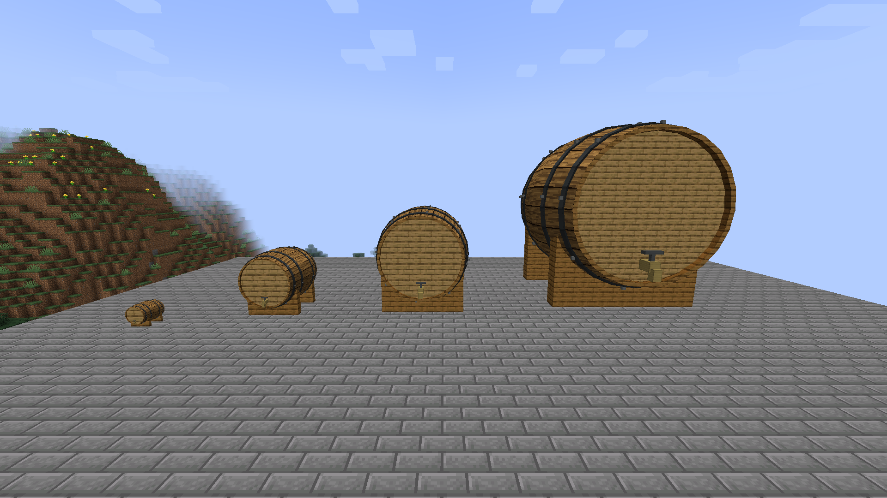
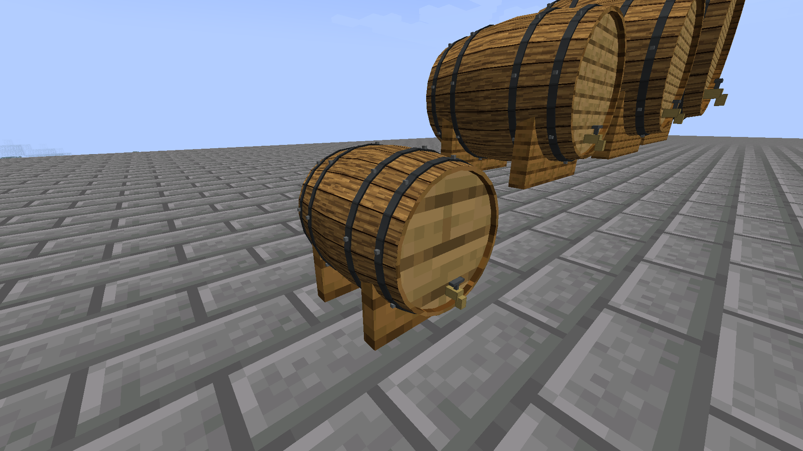

# Project Vinum — Minecraft 1.21.1

A unified NeoForge port of the released tequila mod from `boredhero/pv`
(`1.15.2-0.1.0-HOTFIX`) and the wine prototype from `boredhero/project-vinum`
(`401c3ee`). The mod ID and all content namespaces are now `vinum`.

## Requirements and installation

- Minecraft **1.21.1**
- NeoForge **21.1.262** (the version used for development and verification)
- Java **21**

Put the non-sources `vinum-0.3.0.jar` from `build/libs/` in the client's
and server's `mods` directories. CocoLib is no longer required. Use a new world
for this port; migration of saves from the old Minecraft releases is not provided.

## Included content

The tequila production chain includes wild agave, plantable seeds, cooked agave,
timed wort fermentation, the four-part steel pot still, silver and golden tequila,
shots, and the spiced apple margarita. Reusable tools and barrels survive crafting.
Drinks affect blood alcohol content (BAC), with the original progression of
benefits and penalties, a client HUD, and gradual recovery.

The wine content includes six grape varieties, seeds, juices, bottles, drinkable
glasses, lead ore and metal, three falling sands, and two translucent glass blocks.
Universal oak barrels store, age, and dispense wine and spirits. All six grape
varieties grow from seeds and occur as mature wild bushes in newly generated
plains, forests, birch forests, flower forests, and meadows. Juice and skin-on must
ferment in glass carboys or wooden vats; both wine and tequila are survival-producible.

## Universal oak barrels

Craft an **Oak Barrel** using the existing barrel recipe. Place barrels facing the
same direction: complete solid cubes automatically combine, from **1×1×1 through
9×9×9**, including even sizes. Partial additions remain separate until a larger
compatible cube is complete. Different fluids or facings cannot share a reservoir.
Each block contributes **225 L** by default: a 3×3×3 barrel holds 6,075 L and a
9×9×9 barrel holds 164,025 L. Larger connected builds never create a reservoir
larger than 9×9×9.

All sizes use curved oak staves, metal hoops, plank ends, crescent-shaped wooden rests, and a visible
tap. There are no content names painted on the barrel. Right-click with an empty
hand to inspect the fluid, volume, capacity, age, and dimensions.





- Pour a filled spirit or wine bottle into a barrel by right-clicking it.
- Tap with an empty fifth or wine bottle to draw **750 mL**, or with an empty wine
  glass to draw **125 mL**. A full serving must fit; partial transfers do not consume
  the container.
- Water/lava buckets and NeoForge fluid pipes also work. A reservoir stores one
  compatible fluid at a time; unknown fluids work without beverage-specific code.
- Breaking a block preserves that block's local share in the dropped barrel.
  Remaining blocks separate safely. Filled dropped barrels do not stack, and
  replacing one restores its liquid without claiming the former structure.

### Aging and maturation

`fluidContentAge` records elapsed **world game ticks**, independent of the day/night
clock. Aging continues while a barrel's chunk is unloaded if the server world is
running. It pauses while the world is closed and while contents are in a bottle
or a carried barrel item. Emptying a barrel resets its batch age. Combining batches
of the same fluid uses volume-weighted age; adding fresh liquid dilutes that age.

| Beverage | Default maturation stages |
| --- | --- |
| Tequila | Blanco; reposado at 60 game days; añejo at 365; extra añejo at 1,095 |
| All six wines | Young; mature at 180 game days; reserve at 730 |

Tapping tequila selects the appropriate bottle. Wine retains its variety and shows
its age and maturation stage in the bottle/glass tooltip. Aging does not increase
the drink's alcohol dose. The original golden-tequila recipe remains a separate
legacy pathway, distinct from this age-based system.

Capacity, maturation-day duration, and thresholds are configurable in each world's
`serverconfig/vinum-server.toml`. One maturation day defaults to 24,000 ticks
(20 minutes at 20 TPS). Tequila timing is inspired by the
[CRT's maturation categories](https://www.crt.org.mx/en/our-tequila/), with two months
approximated as 60 days. Wine milestones are gameplay defaults, not universal wine
quality rules. Vessel-size regulations, evaporation, oxidation, and fermentation
chemistry are not simulated yet. Third-party containers must preserve fluid
components to retain age; Vinum bottles/glasses and its vanilla-bucket interactions do.

### Extending beverages

Storage and assembly never branch on individual wine or liquor names:

- `BarrelBlockEntity` owns local fluid and age; its `BarrelContents` snapshot exposes
  fluid type, amount, capacity, age, and availability. Every part retains ownership
  of its saved liquid, so a controller is not a single point of data loss.
- `BarrelMultiblock` manages bounded, queued topology updates. Fluid transfers
  reject unavailable chunks rather than loading them or modifying a partial tank.
- `BeverageDefinition` supplies a fluid, an `AgingProfile`, and `Serving` definitions
  for empty containers, volumes, and filled variants. `BarrelBottling` handles all
  profiles through the same exact-volume transaction path.

To add another wine or spirit, register its fluid/items, then register one
`BeverageDefinition` with `BeverageCatalog.register(...)` during common setup
(`enqueueWork` when called from parallel mod loading). A profile can keep the same
item through all stages, like wine, or select different items, like tequila.
No barrel, multiblock, or renderer changes are needed. Fluid and item stacks carry
the shared `vinum:fluid_content_age` data component through transfers.

The seven legacy barrel registry IDs still load existing blocks, but now use the
same universal storage and unlabelled appearance. Only the canonical oak barrel is
offered in the creative tab.

## Fermentation and preparation

- Craft a **Carboy** from three glass blocks, a glass bottle, and an oak slab. It
  holds 4 L and accepts clarified liquids. Its narrow neck rejects skin-on must.
- Craft **Fermentation Vat** blocks from three oak planks and an iron ingot.
  Complete square footprints combine at widths 1, 2, and 3, independently of
  heights 1, 2, and 3, with 16 L per block (maximum 432 L). A **2×2 footprint one
  block high holds 64 L**; 3×3 one high holds 144 L. Place every segment in the
  footprint and height; empty space inside the rendered vat is intentional.
- Craft a reusable **Wine Press** from a piston, iron ingot, and oak planks. One
  grape item, the press, and a glass bottle prepare 1 L of juice. One grape item,
  the reusable juicer, and a bowl prepare 1 L of skin-on must.
- Right-click a vessel with prepared juice, must, or unfermented agave wort to
  pour it. Juice returns a glass bottle; must returns a bowl. Fill the batch first,
  then **sneak-right-click with an empty hand to start**. Ordinary empty-hand use
  reports contents and progress. Active batches reject transfers to protect their
  composition and processing clock.
- Wild fermentation takes **24,000 loaded-world ticks** (20 minutes at 20 TPS).
  Optional wine yeast doubles the rate; craft it from wheat, sugar, and a brown
  mushroom. Batches pause in unloaded chunks, while the world is closed, and while
  carried as items. They do not spoil for lack of tending.
- Finished juice becomes wine directly. Skin-on must retains its skins: right-click
  the finished vat with the reusable Wine Press to separate them before bottling
  or transferring into a carboy. Pressing is a simplified separation step with no
  liquid loss; separate pomace items and sediment racking are not simulated.
- Craft empty wine bottles from a glass bottle and green dye, or empty wine glasses
  from a glass bottle and glass pane. Empty wine bottles draw 750 mL; glasses draw 125 mL. Ordinary empty buckets draw
  1 L into a metadata-preserving Batch Bucket, which can pour into another vessel,
  aging barrel, or the still's input slot. Partial servings never consume items.
- Breaking a filled vessel preserves its local fluid and fermentation progress in
  the dropped item. Splitting a vat preserves each physical part's owned contents.
  Compatible inactive batches can assemble; active batches cannot join a new vat.

### Production extension contract

`production/BatchProfile` is immutable, validated, and serialized as the
`vinum:batch_profile` fluid component. Sugar, starch, and solids use grams per litre;
ABV and ingredient proportions use fractions. Volume stays on `FluidStack`, so
copying a smaller amount cannot duplicate an entire batch's sugar or alcohol.
Yeast identity and a bounded processing history travel through buckets, bottles,
barrels, and distillation. Different component profiles are conservatively kept
separate by storage; `BatchProfile.blend` provides explicit volume-weighted blending
for future blend operations. Fermentation progress lives on the vessel, separate
from the barrel's maturation age. Active recipe plans persist across save/reload.

`ProductionInputs.register(itemId, fluidId, defaultProfile)` adds a prepared input
without adding beverage branches to vessels. Register fluids/items first, then
register input adapters during common setup. Processing recipes are data-pack
recipes in `data/<namespace>/recipe/`; for example:

```json
{
  "type": "vinum:fermentation",
  "input_fluid": "example:grain_wort",
  "output_fluid": "example:grain_wash",
  "duration_ticks": 24000,
  "sugar_consumed_g_per_litre": 180,
  "alcohol_yield_fraction": 0.0006,
  "solids_remaining_fraction": 1.0
}
```

`FermentationEngine` handles sugar conversion; `MashingRecipe`/`MashingEngine`
provide heat-gated starch conversion; `DistillationRecipe` declares wash, output
fluid/item, strength, volume, and processing duration. Distillation rounds input
volume up to conserve alcohol. A future whisky module can register grain inputs,
mashing recipes, wash, and spirit outputs without changing fermenter storage.
A player-operated mash tun and playable whisky, rum, cider, and mead are future
content, not included in this update. Temperature control, spoilage, clay jars,
metal fermenters, and stirring bonuses are also not implemented.

### Scripted test harness

The development-only test mod contains reusable world and real-client scenario
runners. Close any client using this checkout before launching the dedicated
profile; this avoids mixing old loaded classes with a fresh compilation:

```sh
./gradlew runTestClient
```

This profile uses its own `run-test-client/` directory and loads the test mod.
Create a disposable flat Creative world with cheats enabled. The ordinary
`runClient` profile and release JAR exclude the harness.

Run real-client scenarios from chat:

```mcfunction
/vinumclienttest list
/vinumclienttest runall
/vinumclienttest run carboy_interaction
/vinumclienttest run still_menu
/vinumclienttest run shallow_vat
/vinumclienttest status
/vinumclienttest cancel
/vinumclienttest restore
```

Use `runall` to execute the suite sequentially; a failure or cancellation stops it.
The scenarios execute automatically: carboy fill/start and client synchronization;
opening the actual still screen and moving a bottle through its slots; and placing
the last segment of a shallow vat. Actions use Minecraft's client interaction and
container APIs, including network packets. They do not call the fermentation
engine directly to pretend a client interaction happened. These are targeted
functional scenarios, not screenshot comparisons or proof of every rendering detail.

The runner requires singleplayer Creative with cheats. It reserves an empty loaded
air volume near and above the player (searching up to 16 blocks horizontally and
64 above), faces the camera toward the fixture, snapshots inventory and position, and restores
state and removes fixtures after success, failure, or cancellation. Unexpected
container screens abort; typing in chat pauses action steps. If the world is closed
during a test, reconnect and run `restore` before starting another test. Recovery
data stays with the original saved player/world until restoration succeeds.
Each step pauses for half a second so fixtures and interactions are visible.
The development JVM property `vinum.clientTestStepDelayTicks` adjusts that delay (0–40 ticks).

Client reports are in `run-test-client/client-test-results/<scenario>.json`, with
outcome, completed steps, and the failing step or timeout. New scenarios implement
`ClientScenario` with named `Sequence.action`/`await` steps; use `ClientTestContext`
for authoritative server work and actual client actions. Keep waits conditional,
use explicit timeouts, and keep world/player mutations within the fixture lifecycle.

World/server scenarios can also run visibly in that test world:

```mcfunction
/vinumtest list
/vinumtest runall
/vinumtest run scriptedwinescenariousesactionswaitsandassertions
/vinumtest failed
/vinumtest report
```

These delegate to Minecraft's GameTest system, build fixture scenes, and assert
world state. They use server actors, so they complement real-client scenarios
rather than establish that a GUI or input path works. Native `/test` commands also
remain available. `vinum-test-results.json` and `vinum-gametest-results.xml` in the
run directory record world-test outcomes; JSON updates after each completed test.

`test/harness/GameScenario` provides reusable actions and assertions. For example:

```java
GameScenario.begin(helper)
    .place(pos, ModBlocks.CARBOY.get())
    .equip(new ItemStack(ModItems.GRAPE_JUICE_CHARDONNAY.get())).use(pos)
    .expectFluid(pos, ProductionInputs.id("juice_chardonnay"), 1000)
    .sneakUseEmptyHand(pos)
    .step("assert processing", scene -> helper.assertTrue(scene.vessel(pos).isFermenting(), "Not fermenting"))
    .succeed();
```

`ScenarioLibraryGameTests` contains a full runnable example with timed waits,
bottling, and quantity assertions. Each test's `@GameTest` timeout bounds waiting.
Named steps appear in failure messages. Existing headless CI continues to run
these world scenarios with `./gradlew runGameTestServer`.

An optional test add-on JAR is available with `./gradlew testHarnessJar`. It is
built separately, never included in the production JAR, and client scenarios
require the dedicated `-Dvinum.clientTests=true` JVM flag. Prefer the dedicated
Gradle profile to get matching classes, test registration, flags, and assets.

### Manual client checks

Automated server tests verify processing and persistence; visual/client behavior
requires manual testing. Use a disposable Creative world with cheats enabled:

1. Get Carboy, Fermentation Vat, juice, must, wine yeast, Wine Press, empty wine
   bottles, and ordinary buckets from the Vinum/vanilla tabs.
2. Confirm juice enters a carboy, while must is rejected unchanged. Fill a vat
   with must and confirm an ordinary empty-hand click shows its contents.
3. Add optional yeast and sneak-empty-hand click to start. Active transfers must
   fail without consuming anything. To accelerate a **single** test vessel after
   starting, run `/data merge block X Y Z {FermentationProgress:23980}` using its
   coordinates; it should finish on the next processing tick.
4. Press finished must, then draw a wine bottle and pour it into an aging barrel.
   Confirm the press is reusable and the bottle retains batch metadata.
5. Ferment three wort items, draw three wash buckets, and feed the still with an
   empty fifth and coal. Confirm a silver tequila bottle and emptied wash buffer.
6. Assemble shallow 2×2×1 and taller vats, check the open top and liquid rendering, break/replace a
   filled segment, and save/reopen the world to check contents and progress.

## Tequila quick start

1. Find mature agave in deserts or badlands. Harvest it and replant seeds on sand
   or farmland; bone meal also works. Smelt agave into cooked agave pulp.
2. Blast iron ingots or nuggets into steel. Craft a steel brazier, two steel pots,
   and a steel coil. Place them in a two-by-two vertical arrangement, facing the
   same direction: pot above brazier on the left, coil above pot on the right.
   The still assembles automatically when the last component is placed.
3. Craft cooked agave pulp with a water bucket to make unfermented wort. Pour it
   into a carboy or vat, optionally add wine yeast, and sneak-right-click with an
   empty hand to start. Draw the finished wash with ordinary empty buckets.
4. Open the still and put each wash bucket into its upper-left input slot, removing
   the returned empty bucket between pours. Add an empty fifth bottle and fuel.
   Its 16 L wash buffer also accepts fluid pipes. **3 L of 10% wash produces a
   750 mL bottle at 40% ABV**, taking 1,200 heated ticks (60 seconds). Remaining
   stillage is discarded; evaporation and distillation cuts are not simulated.
   Existing fermented-wort items remain accepted through a 240-tick legacy path,
   but the instant barrel-crafting fermentation recipe has been removed.
5. Craft silver tequila with a reusable barrel to make golden tequila. Combine a
   fifth with a pack of shot glasses for drinkable shots. Craft the margarita with
   two golden tequila shots, apple juice, salt, cinnamon, honey, ice, a margarita
   glass, and a reusable shaker.

The still supports hoppers and NeoForge item handlers: inputs from above, fuel
from the sides, and finished bottles/spent fuel containers from below. Breaking
any part dismantles the structure and drops its inventory once.

The [original tutorial](https://github.com/boredhero/pv/blob/tutorials/src-tutorial/versions/alpha-0.1.0-mmdjam2020/alpha-0.1.0-mmdjam2020.md)
illustrates the recipes and explains BAC. The port fixes several bugs in that
release, including fuel-free progress, invalid output replacement, inconsistent
multiblock orientation, shared item properties, and lost drinking containers.

## Development and checks

```sh
./gradlew build
./gradlew runClient
./gradlew runServer
./gradlew runGameTestServer
python scripts/check_resources.py
```

The wrapper pins Gradle 9.2.1 with a distribution checksum; ModDevGradle 2.0.148
uses Java 21. Runtime data lives in ignored `run/` and `run-gametest/` directories.
GameTests live separately in `src/gametest/` and are excluded from the released jar.
The asset validator checks JSON, references, recipes, models, and textures. Pass
`--minecraft-jar` and `--neoforge-jar` paths to also validate external resources.

Keep changes on a development branch and submit them through a pull request.
Do not commit directly to the upstream `master` branch.

## Continuous integration and downloads

GitHub Actions runs on every branch push and can also be started manually:

| Branch | Checks | Downloadable artifacts |
| --- | --- | --- |
| Any branch except `develop` and `master` | Build, resource validation, Gradle checks, and all server GameTests | Test reports and logs (14 days), including failed runs |
| `develop` or `master` | Build and resource validation | Mod and sources JARs (90 days), after a successful build |

Open **Actions → Build and test → a successful develop/master run → Artifacts**
to download the JAR bundle. Install the JAR without the `-sources` suffix.
Artifact names include the branch and commit SHA to identify each build.

The workflow uses Java 21 and the Gradle wrapper, with GitHub's cache backing
Gradle distributions, dependencies, build outputs, and NeoForm's Minecraft data.
Each branch can save its cache for subsequent pushes. JARs are GitHub Actions
artifacts; the workflow does not create GitHub Releases.

## Credits and license

Project Vinum: Noah Martino (boredhero), Rellit, and Yooks.
Wine prototype: Noah Martino, with credits to Cadiboo's modding tutorial.
The tequila code retains [GPLv3](LICENSE.md); the imported wine prototype retains
its [original license notice](LICENSE-WINE-PROTOTYPE.md). Both notices are included
in the distributed jar.

The new `assets/vinum/textures/block/barrel_oak.png` was generated with the built-in
imagegen tool using the prompt "seamless Minecraft pixel-art oak, vertical grain,
limited warm brown palette, no seams, metal, labels, or lighting," then finalized
at 64×64 using nearest-neighbor scaling. All barrel geometry is implemented in code.
