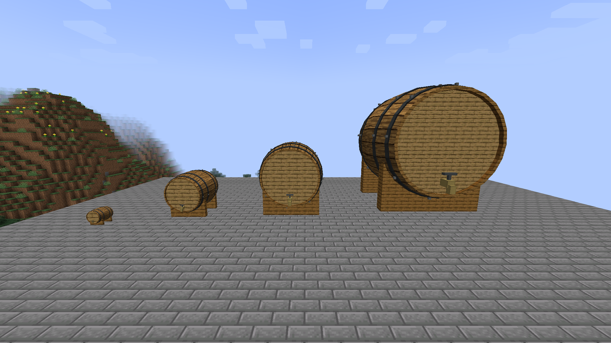
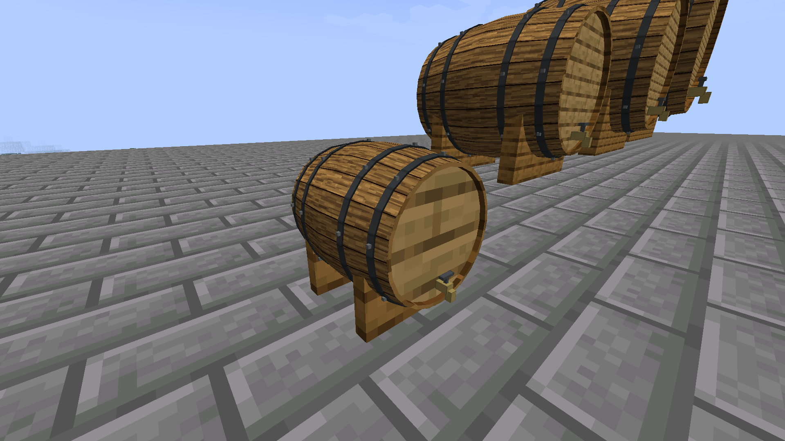

# Project Vinum — Minecraft 1.21.1

A unified NeoForge port of the released tequila mod from `boredhero/pv`
(`1.15.2-0.1.0-HOTFIX`) and the wine prototype from `boredhero/project-vinum`
(`401c3ee`). The mod ID and all content namespaces are now `vinum`.

## Requirements and installation

- Minecraft **1.21.1**
- NeoForge **21.1.262** (the version used for development and verification)
- Java **21**

Put the non-sources `vinum-0.3.0.jar` from `build/libs/` in the client's
and server's `mods` directories. CocoLib is no longer required. Use a new world
for this port; migration of saves from the old Minecraft releases is not provided.

## Included content

The tequila production chain includes wild agave, plantable seeds, cooked agave,
timed wort fermentation, the four-part steel pot still, age-classified tequila,
shots, and the spiced apple margarita. Reusable tools and barrels survive crafting.
Drinks affect blood alcohol content (BAC), with the original progression of
benefits and penalties, a client HUD, and gradual recovery.

The wine content includes six grape varieties, seeds, juices, bottles, drinkable
glasses, lead ore and metal, three falling sands, and two translucent glass blocks.
Universal oak barrels store, age, and dispense wine and spirits. All six grape
varieties grow from seeds and occur as mature wild bushes in newly generated
plains, forests, birch forests, flower forests, and meadows. Juice and skin-on must
ferment in glass carboys or wooden vats; both wine and tequila are survival-producible.

## Universal oak barrels

Craft an **Oak Barrel** using the existing barrel recipe. Place barrels facing the
same direction: complete solid cubes automatically combine, from **1×1×1 through
9×9×9**, including even sizes. Partial additions remain separate until a larger
compatible cube is complete. Different fluids or facings cannot share a reservoir.
Each block contributes **225 L** by default: a 3×3×3 barrel holds 6,075 L and a
9×9×9 barrel holds 164,025 L. Larger connected builds never create a reservoir
larger than 9×9×9.

All sizes use curved oak staves, metal hoops, plank ends, crescent-shaped wooden rests, and a visible
tap. There are no content names painted on the barrel. Right-click with an empty
hand to inspect the fluid, volume, capacity, age, and dimensions.





- Pour a filled spirit or wine bottle into a barrel by right-clicking it.
- Tap with an empty fifth or wine bottle to draw **750 mL**, or with an empty wine
  glass to draw **125 mL**. A full serving must fit; partial transfers do not consume
  the container.
- Water/lava buckets and NeoForge fluid pipes also work. A reservoir stores one
  compatible fluid at a time; unknown fluids work without beverage-specific code.
- Breaking a block preserves that block's local share in the dropped barrel.
  Remaining blocks separate safely. Filled dropped barrels do not stack, and
  replacing one restores its liquid without claiming the former structure.

### Aging and maturation

`fluidContentAge` records elapsed **world game ticks**, independent of the day/night
clock. Aging continues while a barrel's chunk is unloaded if the server world is
running. It pauses while the world is closed or contents are carried as items.
Wine bottles placed on a loaded Wine Shelf continue aging; spirits do not gain
barrel maturation while on a shelf. Emptying a barrel resets its batch age. Combining batches
of the same fluid uses volume-weighted age; adding fresh liquid dilutes that age.

| Beverage | Default maturation stages |
| --- | --- |
| Tequila | Blanco; reposado at 60 game days; añejo at 365; extra añejo at 1,095 |
| All six wines | Young; mature at 180 game days; reserve at 730 |

Tapping tequila selects the appropriate bottle. Wine retains its variety and shows
its age and maturation stage in the bottle/glass tooltip. Aging does not increase
the drink's alcohol dose. The old instant golden-tequila crafting shortcut is
removed: maturation happens in the barrel. Bottles and shots display blanco,
reposado, añejo, or extra añejo from their preserved fluid age.

Capacity, maturation-day duration, and thresholds are configurable in each world's
`serverconfig/vinum-server.toml`. One maturation day defaults to 24,000 ticks
(20 minutes at 20 TPS). Tequila timing is inspired by the
[CRT's maturation categories](https://www.crt.org.mx/en/our-tequila/), with two months
approximated as 60 days. Wine milestones are gameplay defaults, not universal wine
quality rules. Vessel-size regulations, evaporation, oxidation, and fermentation
chemistry are not simulated yet. Third-party containers must preserve fluid
components to retain age; Vinum bottles/glasses and its vanilla-bucket interactions do.

### Extending beverages

Storage and assembly never branch on individual wine or liquor names:

- `BarrelBlockEntity` owns local fluid and age; its `BarrelContents` snapshot exposes
  fluid type, amount, capacity, age, and availability. Every part retains ownership
  of its saved liquid, so a controller is not a single point of data loss.
- `BarrelMultiblock` manages bounded, queued topology updates. Fluid transfers
  reject unavailable chunks rather than loading them or modifying a partial tank.
- `BeverageDefinition` supplies a fluid, an `AgingProfile`, and `Serving` definitions
  for empty containers, volumes, and filled variants. `BarrelBottling` handles all
  profiles through the same exact-volume transaction path.

To add another wine or spirit, register its fluid/items, then register one
`BeverageDefinition` with `BeverageCatalog.register(...)` during common setup
(`enqueueWork` when called from parallel mod loading). A profile can keep the same
item through all stages, like wine, or select different items, like tequila.
No barrel, multiblock, or renderer changes are needed. Fluid and item stacks carry
the shared `vinum:fluid_content_age` data component through transfers.

The seven legacy barrel registry IDs still load existing blocks, but now use the
same universal storage and unlabelled appearance. Only the canonical oak barrel is
offered in the creative tab.

## Fermentation and preparation

- Craft a **Carboy** from four glass blocks and a glass bottle. It
  is the same 4 L container used to carry liquid and ferment small batches.
  Use it on the press to collect must, right-click a vat with a filled one to pour,
  or use it on the ground to place it. It carries raw must, fermented must, and young wine.
  Craft an **Airlock** from three glass blocks and one wine cork, then use it on
  the placed carboy before starting fermentation. Vats do not require airlocks.
  Breaking and replacing a carboy preserves its liquid, airlock, and paused
  fermentation progress; changing the liquid while carried resets that progress.
- Craft **Fermentation Vat** blocks from three oak planks and an iron ingot.
  Complete square footprints combine at widths 1, 2, and 3, independently of
  heights 1, 2, and 3, with 16 L per block (maximum 432 L). A **2×2 footprint one
  block high holds 64 L**; 3×3 one high holds 144 L. Place every segment in the
  footprint and height; empty space inside the rendered vat is intentional.
- Craft a **Press** from oak planks, iron, a barrel, and a stone slab. Place
  it with two clear blocks of height. Its wooden basket, central screw, purple
  metal hoops, feet, and catch tray occupy a 1×1×2 space.
- Attach a **Hand Crank** by right-clicking either half. Turn it with an empty
  hand on the upper screw or sneak-right-click the placed machine. The crank
  stays fixed at the top of the screw while the plate descends; there is no GUI crank button.
  Alternatively attach a **Press Motor Upgrade**, then supply FE. A neighboring
  **Basic Generator** burns furnace fuels to supply it. An unpowered press does
  no work; the motor is required for external FE input.
- Put grapes or cooked agave pulp in the press UI or feed them with a hopper above its upper half.
  Each grape produces 1 L of must; each cooked agave pulp produces 1 L of mosto.
  Both take eight manual turns. Each turn directly
  advances progress by one eighth, with a half-second cooldown; manual work never
  creates or requires FE and stops between turns. The manual UI shows progress,
  not an FE bar. The optional motor instead consumes 2,000 FE per batch at up to
  10 FE/tick. The output tank holds 8 L and the motor buffer holds 8,000 FE.
  Incompatible liquid or insufficient tank space pauses processing without
  consuming ingredients or power. Add a carboy to the container slot, or use
  one on the press to draw liquid. Side hoppers insert containers; bottom hoppers
  extract filled containers. Fluid pipes can drain liquid from either half.
  **Purge** discards all liquid currently in the press tank; input items, containers,
  power, upgrades, and pressing progress are preserved.
- The press is the normal source of must; old prepared must bowls remain usable for saved-world compatibility.
- Use a filled carboy on a vessel to pour must, wine, or agave mosto; an empty one draws liquid.
  Right-click with a bowl of must to add it. Liquid stays in its reusable
  container when partially poured; must returns a bowl. Fill the batch first,
  then **sneak-right-click with an empty hand to start**. Ordinary empty-hand use
  reports contents and progress. Active batches reject transfers to protect their
  composition and processing clock.
- Wild fermentation takes **24,000 loaded-world ticks** (20 minutes at 20 TPS).
  Optional wine yeast doubles the rate; craft it from wheat, sugar, and a brown
  mushroom. Batches pause in unloaded chunks, while the world is closed, and while
  carried as items. They do not spoil for lack of tending.
- **Wine route:** Grapes → Press → Carboy of Must → Fermentation Vat →
  Fermented Wine Must → handheld Strainer → Young Wine → aging/bottling.
  For small batches, replace the vat with a placed carboy fitted with an airlock.
- Right-click the vat or placed carboy with a **Strainer** to clear its entire
  finished batch in place. The reusable tool preserves volume, alcohol, age,
  and grape proportions. Raw must and active batches cannot be strained.
  Existing placed strainer blocks remain functional for saved-world compatibility.
- Young wine ages in a barrel or a **placed, airlocked carboy**. Carboy aging
  pauses without an airlock, while carried, or while unloaded. Vats do not age wine.
  Fermented must must be strained before carboy aging begins.
- Craft empty wine bottles from a glass bottle and green dye, or empty wine glasses
  from a glass bottle and glass pane. Empty wine bottles draw 750 mL; glasses draw 125 mL. Ordinary empty buckets draw
  1 L into a metadata-preserving Batch Bucket, which can pour into another vessel,
  aging barrel, or the still's input slot. Partial servings never consume items.
- Bottling wine requires one wine cork in your inventory per newly filled bottle.
  Top-ups use the existing cork; emptying the bottle means the next filling needs
  a fresh one. Glasses and carboys need no cork. For automated filling, craft an
  empty bottle together with a cork first. Failed fills consume nothing.
- Breaking a filled vessel preserves its local fluid and fermentation progress in
  the dropped item. Splitting a vat preserves each physical part's owned contents.
  Compatible inactive batches can assemble; active batches cannot join a new vat.

### Production extension contract

`production/BatchProfile` is immutable, validated, and serialized as the
`vinum:batch_profile` fluid component. Sugar, starch, and solids use grams per litre;
ABV and ingredient proportions use fractions. Volume stays on `FluidStack`, so
copying a smaller amount cannot duplicate an entire batch's sugar or alcohol.
Yeast identity and a bounded processing history travel through buckets, bottles,
barrels, and distillation. Finished wines support volume-weighted blending;
other component profiles are conservatively kept separate by storage. Different
unfermented juice fluids cannot yet co-ferment. Fermentation progress lives on the vessel, separate
from the barrel's maturation age. Active recipe plans persist across save/reload.

`ProductionInputs.register(itemId, fluidId, defaultProfile)` adds a prepared input
without adding beverage branches to vessels. Register fluids/items first, then
register input adapters during common setup. Processing recipes are data-pack
recipes in `data/<namespace>/recipe/`; for example:

```json
{
  "type": "vinum:fermentation",
  "input_fluid": "example:grain_wort",
  "output_fluid": "example:grain_wash",
  "duration_ticks": 24000,
  "sugar_consumed_g_per_litre": 180,
  "alcohol_yield_fraction": 0.0006,
  "solids_remaining_fraction": 1.0
}
```

`FermentationEngine` handles sugar conversion; `MashingRecipe`/`MashingEngine`
provide heat-gated starch conversion infrastructure with no playable machine or
shipped mashing recipes; `DistillationRecipe` declares wash, output
fluid/item, strength, volume, and processing duration. Distillation rounds input
volume up to conserve alcohol. A future whisky module can register grain inputs,
mashing recipes, wash, and spirit outputs without changing fermenter storage.
A player-operated mash tun and playable whisky, cider, and mead are future
content, not included in this update. Temperature control, spoilage, clay jars,
metal fermenters, and stirring bonuses are also not implemented.

### Scripted test harness

The development-only test mod contains reusable world and real-client scenario
runners. Close any client using this checkout before launching the dedicated
profile; this avoids mixing old loaded classes with a fresh compilation:

```sh
./gradlew runTestClient
```

This profile uses its own `run-test-client/` directory and loads the test mod.
Create a disposable flat Creative world with cheats enabled. The ordinary
`runClient` profile and release JAR exclude the harness.

Run real-client scenarios from chat:

```mcfunction
/vinumclienttest list
/vinumclienttest runall
/vinumclienttest run carboy_interaction
/vinumclienttest run still_menu
/vinumclienttest run shallow_vat
/vinumclienttest status
/vinumclienttest cancel
/vinumclienttest restore
```

Use `runall` to execute the suite sequentially; a failure or cancellation stops it.
The scenarios execute automatically: carboy fill/start and client synchronization;
opening the actual still screen and moving a bottle through its slots; and placing
the last segment of a shallow vat. Actions use Minecraft's client interaction and
container APIs, including network packets. They do not call the fermentation
engine directly to pretend a client interaction happened. These are targeted
functional scenarios, not screenshot comparisons or proof of every rendering detail.

The runner requires singleplayer Creative with cheats. It reserves an empty loaded
air volume near and above the player (searching up to 16 blocks horizontally and
64 above), faces the camera toward the fixture, snapshots inventory and position, and restores
state and removes fixtures after success, failure, or cancellation. Unexpected
container screens abort; typing in chat pauses action steps. If the world is closed
during a test, reconnect and run `restore` before starting another test. Recovery
data stays with the original saved player/world until restoration succeeds.
Each step pauses for half a second so fixtures and interactions are visible.
The development JVM property `vinum.clientTestStepDelayTicks` adjusts that delay (0–40 ticks).

Client reports are in `run-test-client/client-test-results/<scenario>.json`, with
outcome, completed steps, and the failing step or timeout. New scenarios implement
`ClientScenario` with named `Sequence.action`/`await` steps; use `ClientTestContext`
for authoritative server work and actual client actions. Keep waits conditional,
use explicit timeouts, and keep world/player mutations within the fixture lifecycle.

World/server scenarios can also run visibly in that test world:

```mcfunction
/vinumtest list
/vinumtest runall
/vinumtest run scriptedwinescenariousesactionswaitsandassertions
/vinumtest failed
/vinumtest report
```

These delegate to Minecraft's GameTest system, build fixture scenes, and assert
world state. They use server actors, so they complement real-client scenarios
rather than establish that a GUI or input path works. Native `/test` commands also
remain available. `vinum-test-results.json` and `vinum-gametest-results.xml` in the
run directory record world-test outcomes; JSON updates after each completed test.

`test/harness/GameScenario` provides reusable actions and assertions. For example:

```java
GameScenario.begin(helper)
    .place(pos, ModBlocks.CARBOY.get())
    .equip(new ItemStack(ModItems.GRAPE_JUICE_CHARDONNAY.get())).use(pos)
    .expectFluid(pos, ProductionInputs.id("juice_chardonnay"), 1000)
    .sneakUseEmptyHand(pos)
    .step("assert processing", scene -> helper.assertTrue(scene.vessel(pos).isFermenting(), "Not fermenting"))
    .succeed();
```

`ScenarioLibraryGameTests` contains a full runnable example with timed waits,
bottling, and quantity assertions. Each test's `@GameTest` timeout bounds waiting.
Named steps appear in failure messages. Existing headless CI continues to run
these world scenarios with `./gradlew runGameTestServer`.

An optional test add-on JAR is available with `./gradlew testHarnessJar`. It is
built separately, never included in the production JAR, and client scenarios
require the dedicated `-Dvinum.clientTests=true` JVM flag. Prefer the dedicated
Gradle profile to get matching classes, test registration, flags, and assets.

### Manual client checks

Automated server tests verify processing and persistence; visual/client behavior
requires manual testing. Use a disposable Creative world with cheats enabled:

1. Get Carboy, Fermentation Vat, juice, must, wine yeast, Press, Hand Crank,
   Press Motor Upgrade, Basic Generator, empty wine bottles, and buckets.
2. Confirm both juice and must enter a carboy. Fill a vat
   with must and confirm an ordinary empty-hand click shows its contents.
3. Add optional yeast and sneak-empty-hand click to start. Active transfers must
   fail without consuming anything. To accelerate a **single** test vessel after
   starting, run `/data merge block X Y Z {FermentationProgress:23980}` using its
   coordinates; it should finish on the next processing tick.
4. Draw finished fermented must into a carboy, place it, and right-click with a Strainer.
   Pour the strained wine into an aging barrel or bottle it; confirm volume,
   alcohol, age, and grape proportions remain unchanged.
5. Press three cooked agave pulp into 3 L of mosto, ferment it, and feed the still with an
   empty fifth and coal. Confirm a blanco tequila bottle and emptied wash buffer.
6. Assemble shallow 2×2×1 and taller vats, check the open top and liquid rendering, break/replace a
   filled segment, and save/reopen the world to check contents and progress.

## Tequila quick start

1. Find occasional agave colonies in newly generated deserts or badlands: a mature
   center with younger plants around it. Craft a Jimador's
   Coa from three iron ingots and two sticks, clip the leaves, then harvest the exposed
   piña with the coa. Disconnected leaf tips fall away with the cut. Replant seeds on
   sand or farmland; bone meal advances growth. Smelt the piña into cooked agave pulp.
2. Blast iron ingots or nuggets into steel. Craft a steel brazier, two steel pots,
   and a steel coil. Place them in a two-by-two vertical arrangement, facing the
   same direction: pot above brazier on the left, coil above pot on the right.
   The still assembles automatically when the last component is placed.
3. Put cooked agave pulp in the **Press**. Each pulp yields **1 L of agave mosto**
   after eight crank turns or 2,000 FE through the motor. Draw it into a reusable
   carboy (or pipe it directly to a vessel). Pour it into a carboy or vat,
   optionally add wine yeast, and sneak-right-click with an
   empty hand to start. Draw the finished wash into a reusable carboy or ordinary
   empty buckets.
4. Open the still and put the wash container into its upper-left input slot,
   removing the returned empty container between pours. A partially emptied
   carboy retains its remaining wash. You can also sneak-use a filled carboy on
   the assembled still to pour directly. Add an empty fifth bottle and fuel.
   Its 16 L wash buffer also accepts fluid pipes. **3 L of 10% wash produces a
   750 mL bottle at 40% ABV**, taking 1,200 heated ticks (60 seconds). Remaining
   stillage is discarded; evaporation and distillation cuts are not simulated.
   The obsolete fermented-wort item bypass is removed: every batch uses the
   actual fermented fluid and recipe duration. An incomplete or unloaded still
   pauses processing without consuming heat or wash.
5. Age tequila in a barrel to obtain reposado, añejo, and extra añejo. Open a pack
   to receive eight reusable shot glasses. A shot holds 50 mB: draw from a barrel,
   or hold a bottle in the offhand and use the shot glass in the main hand. Craft
   a margarita with two full tequila shots, apple juice, salt, cinnamon, honey,
   ice, a margarita glass, and a reusable shaker. The two empty shot glasses and
   shaker return as crafting remainders. Empty glasses or water do not satisfy
   the tequila requirement.

For salt, place a standalone dry **Steel Pot** above a lit campfire or steel
brazier. Use a water bucket on the pot: the bucket returns immediately. After
100 heated ticks (five seconds), use an empty hand to collect the salt. Losing
heat pauses evaporation. Collect the contents before using that pot in a still.
Cinnamon is harvested by axe-stripping cinnamon logs; apple juice
returns its glass bottle when drunk or used in crafting.

The special glass chain is also obtainable: wash sand with a water bucket to
make refined sand (returning the bucket), then mix in iron powder for ferrous sand
or lead powder for leaded sand. Smelt those into dark wine glass or fine crystal
glass respectively. An iron nugget makes one iron powder; a lead ingot makes nine
lead powder. Lead ore smelts or blasts into ingots; nine ingots pack into a
reversible lead block. These preparation recipes abstract the real processing.

The [production architecture audit](docs/production-audit.md) records the complete
wine/tequila paths, repaired gaps, and unfinished mechanics such as explicit uncorking,
pre-fermentation blending, and a playable mash tun.

The still supports hoppers and NeoForge item handlers: inputs from above, fuel
from the sides, and finished bottles/spent fuel containers from below. Breaking
any part dismantles the structure and drops its inventory once.

The [original tutorial](https://github.com/boredhero/pv/blob/tutorials/src-tutorial/versions/alpha-0.1.0-mmdjam2020/alpha-0.1.0-mmdjam2020.md)
illustrates the recipes and explains BAC. The port fixes several bugs in that
release, including fuel-free progress, invalid output replacement, inconsistent
multiblock orientation, shared item properties, and lost drinking containers.

## Development and checks

```sh
./gradlew build
./gradlew runClient
./gradlew runServer
./gradlew runGameTestServer
python scripts/check_resources.py
```

The wrapper pins Gradle 9.2.1 with a distribution checksum; ModDevGradle 2.0.148
uses Java 21. Runtime data lives in ignored `run/` and `run-gametest/` directories.
GameTests live separately in `src/gametest/` and are excluded from the released jar.
The asset validator checks JSON, references, recipes, models, and textures. Pass
`--minecraft-jar` and `--neoforge-jar` paths to also validate external resources.

Keep changes on a development branch and submit them through a pull request.
Do not commit directly to the upstream `master` branch.

## Continuous integration and downloads

GitHub Actions runs on every branch push and can also be started manually:

| Branch | Checks | Downloadable artifacts |
| --- | --- | --- |
| Any branch except `develop` and `master` | Build, resource validation, Gradle checks, and all server GameTests | Test reports and logs (14 days), including failed runs |
| `develop` or `master` | Build and resource validation | Mod and sources JARs (90 days), after a successful build |

Open **Actions → Build and test → a successful develop/master run → Artifacts**
to download the JAR bundle. Install the JAR without the `-sources` suffix.
Artifact names include the branch and commit SHA to identify each build.

The workflow uses Java 21 and the Gradle wrapper, with GitHub's cache backing
Gradle distributions, dependencies, build outputs, and NeoForm's Minecraft data.
Each branch can save its cache for subsequent pushes. JARs are GitHub Actions
artifacts; the workflow does not create GitHub Releases.

## Credits and license

Project Vinum: Noah Martino (boredhero), Rellit, and Yooks.
Wine prototype: Noah Martino, with credits to Cadiboo's modding tutorial.
The tequila code retains [GPLv3](LICENSE.md); the imported wine prototype retains
its [original license notice](LICENSE-WINE-PROTOTYPE.md). Both notices are included
in the distributed jar.

The new `assets/vinum/textures/block/barrel_oak.png` was generated with the built-in
imagegen tool using the prompt "seamless Minecraft pixel-art oak, vertical grain,
limited warm brown palette, no seams, metal, labels, or lighting," then finalized
at 64×64 using nearest-neighbor scaling. All barrel geometry is implemented in code.

### Shared beverage containers and colors

Wine now uses the single `vinum:wine` fluid. Its `vinum:batch_profile` component
stores ingredient proportions, alcohol fraction, concentrations, yeast, and
process history. Wine blends preserve volume-weighted composition and maturation
age. Differing unknown components prevent mixing rather than silently losing data.

The reusable wine glass holds 125 mB, the wine bottle 750 mB, and the portable
carboy 4,000 mB, matching the placed carboy. Use on a storage vessel to draw
liquid; sneak-use to pour with bottles/glasses. A filled carboy pours on ordinary use,
and an empty carboy draws. Transfers can be partial and preserve the remainder.
The tooltip shows current amount, capacity, ABV, and ingredient proportions; the
item bar and liquid surface indicate fullness. Use a filled wine glass in the air
to drink it. Container acceptance and drinkability are separate fluid tags:
`data/vinum/tags/fluid/container_contents.json` and `drinkable.json`.

Process grapes in the placed, powered **Press** to produce 1,000 mB of must
per grape. Fill an **empty carboy** from its tank. Craft the carboy from four glass
blocks and a glass bottle. Must is transported as liquid; old must bowls are legacy
saved-world adapters and are no longer craftable or shown in Creative.

`src/main/resources/vinum/wines.json` defines ingredient IDs, wine/juice/must RGB
colors (six hexadecimal digits), and default alcohol fractions for wine samples.
These packaged definitions load at startup; restart after changing them. Blended
wine colors are weighted by ingredient proportions. Add a definition for a new
grape ingredient to reuse all container artwork; its grape item, crop, and
production recipes still need registration. New alcohol families can reuse
`FluidContainerItem` and the fluid tags; cross-family mixing is intentionally not
implicit. Wine fermentation recipes retain the input batch composition.

The grape, carboy, wine-glass, and must art is 64×64. Shared container models tint
only the liquid or pulp, leaving glass highlights and wooden bowls unchanged.
`python scripts/generate_beverage_models.py` regenerates the shared fill geometry
from the artwork (requires Pillow). In-game visual verification is still needed:
check grapes in Creative, press must, pour into a placed airlocked carboy, ferment,
right-click with the handheld strainer, then draw into a wine glass and inspect
capacity/color. Repeat with a vat, and check that airlocked carboys age the cleared wine.


### Press recipes, upgrades, and generator

Add a datapack recipe under `data/<namespace>/recipe/pressing/` to extend the
press. Quantities are item counts, mB of fluid, and work units. The `energy` field
is the motor FE cost; manual turns contribute 250 work units directly without
using the FE buffer. For example:

```json
{
  "type": "vinum:pressing",
  "ingredient": {"item": "vinum:grapes_merlot"},
  "count": 1,
  "output": {"id": "vinum:must_merlot", "amount": 1000},
  "energy": 2000
}
```

Recipes must fit the 8,000 mB tank. A running recipe is saved as a snapshot with
its progress; changing or removing the required input cancels that work. Output
keeps its batch components. The press persists its inventory, fluid, energy,
recipe progress, crank, and motor in the dropped block item. Breaking either half
in Survival removes both halves and drops exactly one stored machine.

The Basic Generator produces 20 FE per furnace fuel tick, stores 32,000 FE, and
pushes at most 80 FE/tick total into its loaded neighbors. Coal therefore provides
32,000 FE. It pauses burning when full and preserves fuel-container remainders
(such as a lava bucket's empty bucket). Top/side automation inserts fuel and the
bottom extracts remainders. Its inventory, charge, and remaining burn time survive
pickup and replacement. FE cables from other mods can power the motor too.

### Vineyard grapes and ice gathering

Grow cultivated grapes on a **Grape Trellis**, a two-block-tall wooden frame.
Place frames in a row and use grape seeds on either half to plant them. One
seedling naturally spreads across up to five sections by default; bone meal
never spreads it. Configure `maxTrellisesPerVine` (1–16) in
`vinum-vineyard-server.toml`. Leave
two blocks of clear space above suitable soil when placing a frame. The vine
grows a permanent trunk and horizontal arms, then flowers and develops hanging
3D bunches. Fruit progresses from small green berries through enlargement and
color change to its variety's ripe color.

Right-click each ripe bunch to harvest it separately. Picking grapes leaves the
trellis and plant standing; after both bunches are picked, the established vine
starts another flowering and fruiting cycle. Bone meal advances growth. Wild
bushes still provide seeds and fruit, but seeds planted by players need a
trellis. See [vineyard design and research](docs/vineyards.md).

All grapes use one `vinum:grape_seeds` item with a persistent, synchronized
`vinum:grape_variety` resource-location component. Crop loot, planting, pick-block,
and creative samples retain that variety. The shared 32×32 seed sprite is tinted
from the variety's `must_color` in `vinum/wines.json`; it needs no separate artwork
for each grape. The component points to the corresponding `crop_grape_<variety>`
block. The six old seed item IDs are removed; pre-1.0 saves are not migrated.

Use an **Ice Pick** on ice, packed ice, or blue ice to harvest **1–3 ice cubes**
and consume the ice block. Fortune applies the vanilla ore-style multiplier;
Silk Touch, if present, recovers the block instead. The pick lasts **512 uses**,
accepts Unbreaking/Mending, and can be repaired with steel. Creative use produces
no drops or wear. Ice cubes no longer have a crafting recipe. The harvestable
blocks are controlled by `data/vinum/tags/block/chippable_ice.json`.

Additional client checks: place a press with obstructed headroom (placement must
fail), attach the crank through its upper half, and confirm it appears and turns.
Load grapes with no power (no progress), then crank or install the motor and fuel
an adjacent generator. Check the two-block basket model and purple bands, tank
and energy tooltips, hopper input, and a filled carboy output. Replant each colored
grape seed on a trellis and confirm its variety. Grow all six varieties with
bone meal; check the green, coloring, and ripe bunches, pick each side separately,
and confirm the plant remains and fruits again. Try Fortune on an ice pick. The new
texture files are installed in `assets/vinum/textures/item/`; restart the dev
client to load the Java changes and updated assets together.


### Reusable shots and bottle presentation

`vinum:shot_glass` is the single reusable 50 mB shot item. `fifth_bottle_empty`
is the canonical 750 mB liquor bottle despite its historical registry name.
Both show capacity and batch metadata and preserve partial contents. Normal use
on a vessel draws liquid; sneak-use pours it. With two reusable containers in your
hands, normal use draws from the other hand and sneak-use pours into it. Drinking
a shot consumes its actual fluid/alcohol dose and leaves the same empty glass.
Opening a shot-glass pack produces eight glasses, including when the final pack
vacates your hand slot. Old filled-shot/fifth IDs are hidden adapters; they no
longer represent separately crafted drink types. Creative samples expose the
canonical bottle and glass at the four tequila maturation stages.

Bottle appearance is defined independently of fluid storage and container items:

- `src/main/resources/vinum/bottle_shapes.json` defines each named silhouette,
  a unique nonnegative `modelValue`, its source `texture`, liquid interior, and
  optional primary/secondary label regions. Coordinates use the texture's native
  pixel grid, with exclusive right/bottom bounds. The default shape uses the
  original empty Johnnie Walker-inspired sprite; tequila uses the original
  1800-inspired sprite. These source PNGs are preserved unchanged.
- `src/main/resources/vinum/beverage_appearances.json` maps registered fluid IDs to
  `bottleBaseType`, `liquidColor`, `bottleLabelPrimaryColor`,
  `bottleLabelSecondaryColor`, and a translated `name`. Colors are six-digit RGB.
  Optional `stages` override any of those attributes, including the shape, using
  an existing `agingStage` translation key or `minimumAgeDays`. Last matching
  stage wins. Tequila's configured maturation thresholds therefore control its
  names, amber liquid tones, and silver/gold/dark label palettes together.

Example definition for another registered spirit reusing the tequila silhouette:

```json
{
  "fluids": ["example:spirit"],
  "bottleBaseType": "tequila",
  "liquidColor": "D5A858",
  "bottleLabelPrimaryColor": "204936",
  "bottleLabelSecondaryColor": "E5C878",
  "name": "beverage.example.spirit",
  "stages": [
    {"minimumAgeDays": 365, "bottleLabelPrimaryColor": "35251E"}
  ]
}
```

These packaged definitions load at startup. After adding a new shape or changing
its region geometry, run `python scripts/generate_bottle_models.py`, then restart
the client. Palette edits need only a restart. The generator reads the original
sprites and produces tinted geometry; it does not repaint the source art. A new
shape needs artwork and one definition; it does not need a new item class.
`python scripts/fit_inventory_models.py` fits native three-dimensional inventory
previews after model generation, independently of their placed-world size.

`vinum:fluid_crafting` wraps a shaped recipe with a reusable `container_item`,
`fluid_tag`, and per-serving `amount`. The margarita uses this to require real
tequila and return its emptied glasses while preserving the shaker/honey bottle
remainders. Recipes for new cocktails can use the same serializer.

### Larger plants and renewable ingredients

Blue agave has eight stages and a mature sparse 3×3×3 rosette. See
[agave growth and harvest](docs/agave-growth.md) for spacing, growth, leaf cutting,
and piña harvesting. The harvested piña remains `vinum:agave`, so its cooking,
wort preparation, fermentation, and distillation recipes form the same chain.


Cork oaks grow from their own saplings and appear as rare small groves in the
configured plains, forest, and savanna biome analogues. Their low-forked crowns
are 9–11 blocks tall and up to 14 wide. Use an axe on a trunk to peel 2–3 pieces
of cork bark without felling it; the harvested surface turns brick-red. Bark
regenerates on a living tree after nine Minecraft days by default, configurable
in `vinum-cork-oak-server.toml`. The deadline survives unloading and block pickup;
detached timber cannot regrow bark. Craft cork bark into wine corks. See
[cork oak research, world generation, and harvesting](docs/cork-oak.md).

### Wine cellar storage

Craft a **Wine Shelf** with six planks and two sticks. Each shelf starts empty and
holds nine wine/fifth bottles in a dense 3×3 grid. Existing five-bottle shelves
retain their original bottles; four new corner positions start empty. Use a bottle on a slot
to insert it; use an empty hand on that slot to retrieve it. Each occupied slot
shows a three-dimensional bottle with its contents' bottle style and colors.
Shelves placed alongside or above one another with the same facing join their
outer trim into a cellar wall. Wine ages while the shelf is loaded.

Cork oak logs also craft into planks, stairs, slabs, fences, fence gates, doors,
trapdoors, buttons, and pressure plates. Their 16×16 plank texture matches the
scale of vanilla wood. Harvested cork logs retain their red exposed surface in
the inventory and when replaced.

### Flat inventory sprites

Carboy, airlock, and grape trellis use separate 32×32 GUI sprites; held and placed
models retain their native geometry. Carboy GUI variants preserve the four liquid
fill tiers, batch tint, and installed-airlock indicator. Regenerate the GUI model
wrappers with `python scripts/generate_inventory_models.py`; the carboy and vine
generators also apply them automatically. Sprite prompts and generation method are
recorded in `docs/inventory-sprite-prompts.json`. Test in Creative inventory after
restarting: empty/filled carboys, airlocked carboys, airlock and trellis should show
flat icons, while a placed airlocked carboy should retain the 3D accessory.

### Bar counter

Craft a **Bar Counter** with three wooden slabs across the top and five planks
below (`SSS / P P / PPP`). Counters connect into straight runs and corners. Each
holds five bottles or glasses in an X layout. Right-click the desired position to
place one. Bottles use ordinary empty-hand pickup; glasses use sneak + empty-hand
right-click so normal held right-click can drink from them in place. Occupied slots
support serving between compatible containers rather than replacing the stored item.
Breaking a counter returns every stored item and the counter itself.

Stored items retain their exact volume, alcohol, maturation age, cork, name, and
other components. Display storage does not advance aging. Empty and partly filled
containers are supported; liquid height follows the interior volume of the selected
profile. Rectangular tequila bottles use centered label artwork from their item sprite.
Shot, wine, and margarita glass profiles preserve their inventory artwork and use
separate placed geometry. See serving controls below.

`vinum:bar_bottles` retains its compatibility ID and now tags all supported counter
items, including drinkware. Inventory/placed beverage appearances are resolved through
`BeverageAppearance`; drinkware uses `drinkware_appearances.json`. Geometry lives in
`bottle_3d_types.json` and is read by the shared `BottleGeometry` catalog.

Manual check: place counters in all four directions; insert five mixed bottles,
including empty, partially filled, and full spirits. Check upright models, labels,
liquid levels and glass against both bright and dark surroundings. Retrieve each
position, reload the world, and break a populated counter to check the drops.

### Bottle appearance definitions

`vinum/beverage_appearances.json` maps fluid IDs to immutable `BeverageAppearance.Style`
objects. `BeverageAppearance.resolve(contents, vessel)` is the presentation boundary;
bar and shelf renderers do not select designs by drink name. Inventory model predicates
and tint handlers consume the same appearance fields. Resolution is read-only and does
not alter chemistry, volume, aging, or item components.

```json
{
  "fluids": ["vinum:tequila"],
  "bottleType": "vinum:tequila",
  "bottle3DType": "vinum:tequila",
  "glassMaterial": {
    "texture": "minecraft:textures/block/white_concrete.png",
    "tint": "7FAAB5",
    "transparency": 0.84
  },
  "label": {
    "artwork": "minecraft:textures/block/white_concrete.png",
    "primaryColor": "969696",
    "secondaryColor": "999999"
  },
  "closure": {
    "type": "cap",
    "texture": "minecraft:textures/block/white_concrete.png",
    "color": "999999"
  }
}
```

`bottleType` references the inventory profiles in `bottle_shapes.json` (compiled by
`scripts/generate_bottle_models.py`). `bottle3DType` references `bottle_3d_types.json`:
polygon sides and ordered `[height, radius]` sections in block units. Geometry is
independent of the bar/shelf and integrates tapered volume for upright fill heights.
Material/artwork paths are texture resources including `textures/` and `.png`;
colors are six-digit RGB, and transparency runs from 0 (opaque) to 1 (invisible).
Label panels select a centered region of the artwork using normalized `panel.uv` coordinates,
with configurable `width`, `bottom`, and `top`. Tequila uses the label region of its existing
inventory texture. Inventory artwork stays in the inventory profile. Closure categories are `cork`, `cap`, and `none`.

Age stages inherit omitted fields, including individual material and label fields.
Unknown fluid designs receive safe bottle defaults; empty wine vessels retain wine
geometry and cork semantics. Legacy `bottleBaseType` and flat palette keys remain
read-compatible. Design identities use typed resource IDs, not enum ordinals.
A future per-item design component should override the resolved defaults at this
boundary; no UUID storage, player designer, or custom-design network protocol is
implemented yet. Packaged profiles currently load at startup.

Bar counters have five click-targeted bottle positions in an X: four corners and a
center. Aim at the desired position to place or retrieve a bottle. Stored slot IDs
remain unchanged when upgrading; existing bottles move to the new positions without
losing contents. Adjacent counters connect on all four horizontal sides regardless of bottle-facing
direction. Bodies meet at shared edges, and panel trim and footrails follow only
the exposed perimeter, including L corners and U-shaped runs. Removing a neighbor
restores its exposed edge. Existing counters refresh their joins when loaded.

Bottle geometry profiles optionally specify positive `widthScale` and `depthScale`
(default 1). Tequila uses a broad rectangular footprint; the bar preserves these
proportions and the cellar shelf scales the same profile to fit its openings.

### Serving and drinking at the bar

Place bottles, shot glasses, wine glasses, empty margarita glasses, or spiced apple
margaritas in any of the five counter positions. Their inventory art is unchanged;
placed glasses use profiles in `drinkware_appearances.json` and `bottle_3d_types.json`.
Glass profiles declare `liquidBottom` and `liquidTop`, so only the bowl fills, not
the stem. Actual liquid quantity determines the visible surface height.

Right-click a placed bottle with a glass to draw a serving. Right-click a placed
glass with a bottle to pour into it; sneak-use explicitly pours the held container.
Transfers preserve partial amounts, ingredients, alcohol, and age. Hold right-click
with an empty main hand while aiming at a placed drink to drink it in place; release,
look away, or leave reach to cancel. The empty glass stays on the counter and normal
drink effects still apply. Placed servings empty in both Creative and Survival;
Creative only retains infinite drinks when drinking from your hand.
**Shift-right-click with an empty hand picks up glasses**;
bottles retain ordinary empty-hand pickup. The server enforces the normal drinking
duration; repeated packets in one tick cannot accelerate it.

Place a barstool beside the counter and right-click to sit. Sneak to stand up.
A stool seats one player and does not leave persistent seat entities behind.


## Sugar processing and rum

Sugarcane no longer crafts directly into sugar. The vanilla honey-to-sugar recipe
and existing sugar drops remain. Cane processing produces normal Minecraft sugar
with provenance metadata; it works in ordinary crafting, while only cane-derived
sugar can be dissolved into rum wash. This prevents honey sugar from silently
becoming cane rum.

### Equipment and controls

- **Sugar Kettle:** craft `C C / CIC /  I `, where C is copper ingot and I is iron
  ingot. Place above a lit campfire or steel brazier. Capacity: 4,000 mB.
- **Sugar-Separation Insert:** craft `III / S S`, where I is iron nugget and S is
  string. Right-click the kettle to install it once; it is reusable.
- Shift-right-click the kettle with an empty hand to cycle **Concentrate Syrup**,
  **Separate Sugar**, and **Make Panela**. Ordinary empty-hand right-click starts
  the selected process, or collects its solid output. The status message reports
  mode, liquid, sugar concentration, output, separator, and progress.
- Shift-right-click with a filled carboy to pour into the kettle; ordinary
  right-click with a carboy draws out. Water buckets add 1,000 mB; right-click
  with panela or cane-derived sugar to dissolve one item. Processing locks
  transfers and pauses without heat. Breaking the kettle preserves its batch,
  output, insert, and process progress in the dropped item.
- **Rum Bottle:** craft ` G /G G/GGG` (center G in the first row), with glass,
  for one 750 mB bottle. First filling with rum consumes a wine cork from
  inventory; top-ups do not. Bottle + wine cork also prepares an empty bottle
  for automated filling. GUI art is flat; placed bottles use separate faceted
  geometry, a transparent X-shaped label, a wide cork, and actual liquid height.

### Feedstock routes

All quantities are gameplay units, not real-world factory yields.

1. **Fresh juice:** 4 sugarcane → press (4 cranks or 2,000 FE) → 1,000 mB cane
   juice + 1 bagasse → optionally strain → fermentation. Bagasse burns for 100
   ticks as a small fuel.
2. **Syrup:** 1,000 mB juice → kettle Concentrate (200 heated ticks) → 250 mB
   syrup → add 750 mB water → 1,000 mB prepared cane wash.
3. **Molasses:** 250 mB syrup → kettle Separate Sugar with insert (300 heated
   ticks) → 1 sugar + 250 mB molasses → collect sugar; add 250 mB water to the
   molasses → 500 mB wash. This divides the original 200 g sugar equivalent into
   100 g in crystals and 100 g remaining in molasses.
4. **Panela:** 250 mB syrup → kettle Make Panela (300 heated ticks) → 1 panela;
   dissolve it in 1,000 mB water → 1,000 mB wash.
5. **Sugar fraction:** dissolve 2 cane-derived sugar in 1,000 mB water → wash.
6. **Mixed:** combine compatible cane juice, diluted syrup, molasses, and
   dissolved sugar/panela in a kettle, vat, or carboy. Ingredients and sugar
   concentration travel with the batch. Water changes concentration without
   replacing the feedstock provenance.

Kettle operations accept complete batches: juice in multiples of 1,000 mB,
then syrup in multiples of 250 mB. Concentrating retains sugar; extracting
crystals removes their sugar from the liquid. Output blockage cannot consume
an input or discard the coproduct. Separation includes crystallization; the
handheld strainer alone cannot extract dissolved sugar.

### Fermentation, distillation, and bottling

**Any prepared cane feedstock → vat OR placed airlocked carboy → fermented cane
wash → strainer if suspended solids remain → still → rum in a carboy.**

Prepare wash at no more than 250 g/L sugar (200 g/L is a useful target). Undiluted
syrup and molasses are too concentrated. Shift-right-click the fermentation
vessel with an empty hand to start; wine yeast is optional and speeds the usual
24,000-tick fermentation. Raw juice can ferment directly. Straining removes
suspended solids, not dissolved sugars or the feedstock's provenance. The still
rejects unstrained solids before accepting wash.

The existing four-part still produces 750 mB of 60% rum into an empty carboy per
1,200 heated ticks. At 12% wash strength it consumes 3,750 mB wash. Output volume
is calculated from actual batch alcohol; dilution never creates alcohol.

**Exact survival proofing:** collect two runs (1,500 mB at 60%) in a placed
carboy or vat. Fill a separate vessel with a water bucket, then draw exactly
750 mB into an empty bottle. Sneak-right-click the rum vessel with that water
bottle: the result is 2,250 mB at 40%, enough for three full rum bottles. Filled
carboys pour into fermentation vessels directly; bottles use sneak-to-pour.

- **White rum:** distill → optionally store in carboy → dilute → corked bottle.
- **Light-aged rum:** distill → barrel for 90 game days → dilute → bottle.
- **Dark-aged rum:** distill → barrel for 365 game days → dilute → bottle.
- **Blended rum:** combine compatible rum batches → dilute → bottle; age is
  volume-weighted between rum batches. Added water preserves the source rum age.

Aging milestones are configurable as `rumLightAgedDays` and `rumDarkAgedDays` in
server barrel config. Glass storage does not mature rum. White/light/dark stages
have clear/gold/deep-amber liquid colors and descriptive tasting notes; the notes
are presentation, not a separate sensory simulation. All stages use the same
rum fluid plus batch and maturation components. Bars support rum bottle
placement, pouring into shot glasses, and drinking placed servings as before.

### Extension points and regression coverage

`vinum/sugar_processes.json` defines kettle input/output volumes, sugar removed
per solid item, heat time, insert requirement, and feedstock identities. For
example, separation maps 250 mB syrup to 250 mB molasses plus one 100 g-equivalent
sugar item. Solid `BatchProfile` concentrations use a documented one-litre
equivalent per item so dissolution can recover exact sugar mass.

Fluid tags `cane_feedstocks`, `blendable_batches`, and `dilutable_batches` control
mixing; recipe sugar bounds control fermentability. Unknown conflicting metadata
is rejected instead of discarded. `BeverageAppearance` owns bottle shapes,
materials, X artwork, closure dimensions, and stage descriptions. Future bottle
IDs can use this boundary without adding rum-specific renderer branches.

Integration tests cover the real press, both fermentation vessels, locked and
persisted kettle operations, coproduct conservation, dissolution, still output,
proofing, maturation, and cork transactions. Client mesh regression exercises the
new bottle through bar and shelf renderers. High-test syrup, skimmings, and spice
infusion are not part of this initial release.


## Cinnamon trees and wood

Cinnamon now comes from **true cinnamon trees** (*Cinnamomum verum*), replacing
spruce-log/shears crafting. The ecological reasoning and primary sources are in
[the habitat research](docs/cinnamon-research.md); inspected cut-stem, bark,
end-grain and leaf references are in [the visual research](docs/cinnamon-visual-references.md).

Natural trees generate in **new jungle chunks** with one attempt per eight
chunks on average, and **new sparse-jungle chunks** with one attempt per twelve.
Attempts can fail when soil, space or loaded-region conditions are unsuitable;
these are gameplay rarity settings, not measured wild-tree density. Trees do not
spawn in swamps, mangroves, savannas, cold forests or bamboo jungle by default.
The two placed-feature JSON files make the rates datapack-configurable. Existing
explored chunks do not retroactively gain trees.

Axe-right-click a cinnamon log or cinnamon wood block to obtain **two cinnamon**
and its stripped variant, consuming one axe durability in Survival. Stripped
blocks retain their state when harvested and replaced, and cannot be crafted back
into barked wood. Leaves drop saplings for renewable cultivation; saplings grow
with ordinary soil/light/bonemeal rules outside the natural biome whitelist too.
The growth feature preflights its footprint and refuses water, player structures,
and unloaded areas rather than replacing them partway through growth.

The wood family includes logs, all-bark wood, stripped variants, planks, stairs,
slabs, fences, fence gates, doors, trapdoors, buttons, pressure plates, leaves and
saplings. Wood has normal crafting tags, fuel/flammability behavior, leaf decay,
Fortune/Silk Touch/shears drops and sapling/leaves composting. Its pale warm wood,
gray-brown bark and pointed three-veined foliage are based on cinnamon references,
not the rolled appearance of the spice.

### Quick in-game checks

- In Creative, place a Cinnamon Sapling on grass with plenty of room and use
  bonemeal. Expect a branched evergreen tree with the new leaf texture.
- In Survival, axe-strip a trunk block: expect two cinnamon, one durability wear,
  and stripped wood. A second use must not yield more cinnamon.
- Use `/locate biome minecraft:jungle` and explore fresh terrain to look for
  natural trees. Rarity is an average placement attempt rate, not a guarantee.
- Place rum bottles on a bar and aim directly at the bottle body/top with an
  empty shot glass: expect 50 mB transferred, bottle reduced by 50 mB, and age/ABV
  preserved in both Creative and Survival. Above-counter targeting uses a
  server-validated ray, including reach and obstruction checks.
- Creative now includes white/light-aged/dark-aged rum shots. Rum names are
  translated; tequila keeps its original silhouette/label layout at 64px.
- Placed shot glasses are shorter; the margarita has a broad shallow bowl, salt
  granules, ice, spice and red/green apple wedges. Inventory glass/cocktail sprites
  remain unchanged.


### Creative wine bottles

The Vinum Creative tab and Creative search include a full, corked 750 mB bottle
of every registered grape variety, at the configured mature-wine age and that
variety's alcohol content. The empty reusable wine bottle remains available.
Red and white wines retain their own liquid colors beneath the shared green glass
and centered label. These are ordinary batch-bearing bottles: place them on the
bar or shelf, pour servings, or move them into Survival without a special creative
item type.

Creative also includes a full 125 mB wine glass for each of the six varieties. Right-click an empty position on the bar to place a glass; its wine variety and maturation are preserved.
